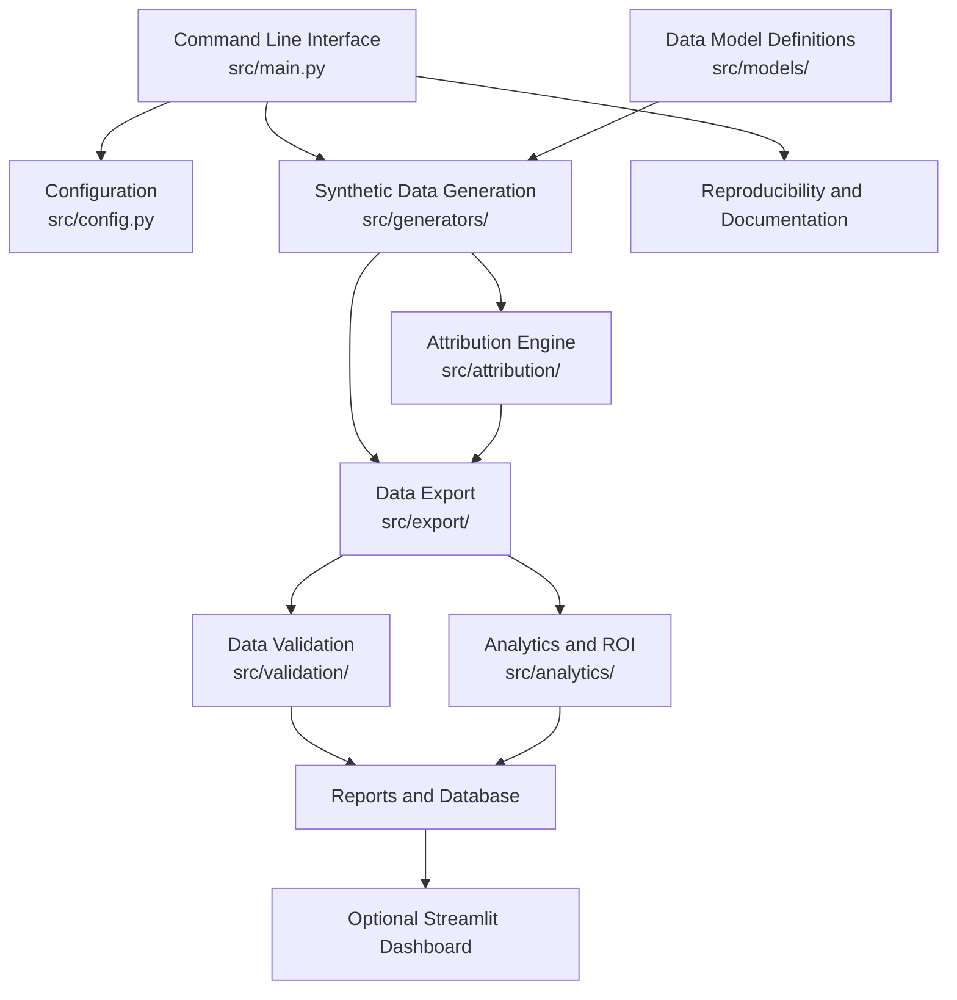
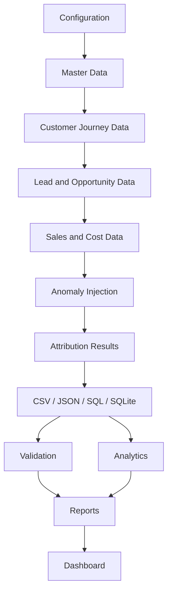

# System Architecture — Marketing Attribution & ROI Analytics

## 1. Introduction

This document describes the architecture, components, data flow and execution workflow of the Marketing Attribution & ROI Analytics project.

The system is implemented as a modular Python pipeline. It generates synthetic marketing datasets, simulates customer journeys, applies attribution models, validates data quality, calculates marketing performance metrics and exports the resulting datasets and reports.

The architecture separates data generation, business logic, validation, analytics and data export so that each component has a clearly defined responsibility.

All data used in the project is synthetic.

## 2. Architecture Overview

The project follows a modular, sequential data-processing architecture.

The main application entry point is `src/main.py`. It coordinates the other modules and provides command-line operations for generating data, validating datasets, building reports, checking reproducibility and generating documentation.

### High-level architecture



The diagram represents the major logical components and their relationships. The actual execution order is controlled by `main.py`, as described below.

## 3. Project Components

### 3.1 Command-Line Application — `src/main.py`

**Responsibility:** Acts as the main entry point and orchestrates the project workflow.

The application supports six commands:

| Command | Responsibility |
|---|---|
| `generate` | Generates and exports synthetic marketing datasets. |
| `validate` | Runs data integrity, temporal, reconciliation and anomaly checks. |
| `report` | Builds attribution, channel ROI and model comparison reports. |
| `reproduce` | Runs the generator twice and compares exported file hashes. |
| `docs` | Generates the data dictionary documentation. |
| `all` | Executes generation, validation, reporting, reproducibility and documentation in sequence. |

The main application passes configuration and output paths to the appropriate modules.

### 3.2 Configuration — `src/config.py`

**Responsibility:** Centralizes dataset generation parameters.

The configuration module defines:

- Default random seed.
- Generator version.
- Dataset reference start date.
- Dataset reference cutoff date.
- Campaign, contact, touchpoint and opportunity volumes.
- Lead and win rates.
- Missing identifier rate.
- Attribution lookback period.
- Anomaly injection counts.

The `Config` dataclass represents the active generation configuration.

The `Config.from_scale()` method adjusts the configured record volumes based on the requested scale.

Example:

| Parameter | Full scale (1.0) | Starter scale (0.05) |
|---|---:|---:|
| Campaigns | 500 | 25 |
| Contacts | 50,000 | 2,500 |
| Touchpoints | 200,000 | 10,000 |
| Opportunities | 10,000 | 500 |

The project uses a fixed reference date and random seed to support repeatable generation.

### 3.3 Data Generation — `src/generators/`

**Responsibility:** Creates the synthetic marketing datasets.

The generator module contains:

| File | Responsibility |
|---|---|
| `__init__.py` | Orchestrates the generation sequence. |
| `constants.py` | Defines channel, audience, cost and generation constants. |
| `master_data.py` | Creates channels, audiences, campaigns, creatives and contact seeds. |
| `transaction_data.py` | Generates customer journeys, touchpoints, leads, opportunities, lifecycle events, sales orders, costs and FX rates. |
| `anomaly_generator.py` | Injects controlled anomalies and records corresponding ground-truth labels. |

The `generate(cfg)` function is the main generation interface.

It initializes a seeded random number generator and a shared generation state containing:

- Configuration.
- Random number generator.
- Generated table collections.
- Ground-truth anomaly records.

The generator then builds the master data, customer journeys and sales lifecycle data in a defined order.

The order of generator function calls is significant because random number consumption affects the generated output.

### 3.4 Data Model — `src/models/`

**Responsibility:** Defines the central data dictionary.

The `data_dictionary.py` module maintains entity definitions, including:

- Entity and table names.
- Column names.
- Data types.
- Primary keys.
- Foreign keys.
- Required fields.
- Allowed enumeration values.
- Relationships and table organization.

The same data dictionary is used by other parts of the application, including database schema generation, validation and documentation.

This reduces duplication of table definitions across the codebase.

### 3.5 Attribution Engine — `src/attribution/`

**Responsibility:** Allocates conversion revenue across eligible marketing interactions.

The attribution module contains:

| File | Responsibility |
|---|---|
| `__init__.py` | Package initialization. |
| `engine.py` | Coordinates eligible-touch selection, evaluation periods and attribution execution. |
| `first_touch.py` | First-touch attribution logic. |
| `last_touch.py` | Last-touch attribution logic. |
| `multi_touch.py` | Linear, time-decay and position-based attribution logic. |

The attribution engine evaluates eligible touchpoints for each sales order.

Important rules include:

- A 120-day attribution lookback window by default.
- Eligibility checks for customer identity and interaction type.
- Exclusion of interactions after conversion from clean attribution.
- Revenue allocation across eligible interactions.
- Explicit treatment of orders without eligible touchpoints.

The five supported attribution models are:

1. First-touch.
2. Last-touch.
3. Linear.
4. Time-decay.
5. Position-based.

Revenue allocation uses integer cents to preserve exact financial reconciliation.

The engine also supports evaluation-period assignment and controlled post-conversion anomaly scenarios.

### 3.6 Data Export — `src/export/`

**Responsibility:** Writes generated and processed data to persistent files and databases.

The exporter supports:

- CSV exports.
- JSON exports.
- SQL schema generation.
- SQL seed data generation.
- SQLite database creation.
- Source manifest generation.

The export process uses the central data dictionary to determine table organization and database schema.

Ground-truth records are stored separately from normal source and processed datasets.

The source manifest records generation configuration, seed, environment information and file metadata, including SHA-256 hashes.

### 3.7 Data Validation — `src/validation/`

**Responsibility:** Validates exported datasets independently of the generator's in-memory state.

The validation module contains:

| File | Responsibility |
|---|---|
| `__init__.py` | Coordinates validation and creates the validation summary. |
| `context.py` | Builds shared lookup structures for validation. |
| `integrity.py` | Checks primary keys, foreign keys, required fields and allowed values. |
| `temporal.py` | Checks chronological and lifecycle rules. |
| `reconciliation.py` | Checks financial consistency and attribution reconciliation. |
| `anomaly_detection.py` | Detects injected anomaly categories and evaluates results against ground truth. |

Validation is performed against exported CSV data loaded through the exporter.

The module evaluates:

- Structural integrity.
- Relationship integrity.
- Allowed values.
- Chronological consistency.
- Financial reconciliation.
- Anomaly detection performance.

The validation summary includes check counts, failures, row counts and anomaly detector metrics.

### 3.8 Analytics and ROI — `src/analytics/`

**Responsibility:** Converts generated and attributed marketing data into business performance reports.

The analytics module contains:

| File | Responsibility |
|---|---|
| `__init__.py` | Coordinates analytics report generation and documents clean-variant decisions. |
| `metrics.py` | Calculates model comparison and supporting marketing metrics. |
| `roi.py` | Calculates campaign, channel and attribution-model revenue and ROI results. |

The analytics process loads exported datasets and evaluates attribution results across models and evaluation periods.

It generates:

- Attribution reports.
- Channel ROI reports.
- Attribution model comparisons.
- Exception reports.
- Model comparison JSON.

The model comparison includes portfolio ROI, unattributed revenue share, channel ranking stability and correlation between campaign credit and synthetic campaign quality.

### 3.9 Shared Utilities — `src/common.py`

**Responsibility:** Provides reusable file and hashing utilities.

The module provides:

- `write_csv()` — writes records to CSV.
- `read_csv()` — reads CSV records into dictionaries.
- `sha256_file()` — calculates a file's SHA-256 hash.

These functions are used across the project to avoid repeating common file-handling logic.

### 3.10 Automated Tests — `tests/`

**Responsibility:** Tests expected system behaviour and detects regressions.

The test suite contains:

| File | Test coverage |
|---|---|
| `conftest.py` | Shared fixture and small-scale generated data. |
| `test_generators.py` | Generation volumes, data layout, identifiers and anomaly injection. |
| `test_attribution.py` | Attribution weights, eligibility and revenue allocation. |
| `test_validation.py` | Structural, temporal, financial and anomaly validation. |
| `test_reproducibility.py` | Same-seed consistency and different-seed behaviour. |

The test suite uses pytest and includes negative tests that deliberately corrupt data to verify that validation catches expected errors.

## 4. End-to-End Execution Workflow

The complete workflow is controlled by `src/main.py`.

When the `all` command is used, the application performs the following operations.

### Step 1: Load configuration

The application reads the configuration file and applies command-line overrides for scale, seed and output directory.

### Step 2: Generate master data

The generator creates channels, audiences, campaigns, campaign relationships, creatives and contact seed data.

### Step 3: Generate customer journeys

The transaction generator creates touchpoints and web sessions, then generates leads, opportunities and their lifecycle events.

### Step 4: Generate sales and financial records

The system creates sales orders, cost records, FX rates and associated relationships.

### Step 5: Inject controlled anomalies

The anomaly generator introduces the specified anomaly scenarios and stores the corresponding ground-truth labels separately.

### Step 6: Generate attribution results

The attribution engine applies the five attribution models to eligible customer interactions and creates attribution result records.

### Step 7: Export datasets

The exporter writes generated tables, ground truth and database deliverables to the selected output directory.

### Step 8: Validate exported data

The validator reloads the exported CSV datasets and performs structural, temporal, reconciliation and anomaly detection checks.

### Step 9: Generate analytics reports

The analytics module calculates attribution model comparisons, campaign ROI, channel ROI and exception reports.

### Step 10: Verify reproducibility

The generator executes twice with the same configuration and random seed. The exported CSV file sizes and SHA-256 hashes are compared.

### Step 11: Generate documentation

The application writes the data dictionary to the output documentation directory.

## 5. Data Flow and Storage

The project separates generated source data, processed data, ground truth, database exports and analytical reports.

### Logical data flow



Ground-truth records are exported separately and used by validation to evaluate anomaly detection results.

### Main output organization

```text
output/
└── full/
    ├── data/
    │   ├── raw/
    │   ├── processed/
    │   ├── ground_truth/
    │   └── json/
    │
    ├── database/
    │   ├── schema.sql
    │   ├── seed.sql
    │   └── attribution.sqlite
    │
    ├── reports/
    │   ├── attribution_report.csv
    │   ├── channel_roi.csv
    │   ├── model_comparison.csv
    │   ├── model_comparison.json
    │   ├── exceptions.csv
    │   ├── validation_summary.json
    │   └── reproducibility_check.json
    │
    ├── docs/
    │   └── data_dictionary.md
    │
    └── source_manifest.json
```

The exact files generated depend on the selected export formats and executed commands.

## 6. Data Quality and Ground-Truth Separation

The architecture separates normal data from expected anomaly labels.

Normal source and processed datasets contain the generated business records. Ground-truth datasets contain the labels used to evaluate the anomaly detector.

The validation module loads the exported data and compares detected anomaly records against the ground-truth records.

This separation helps prevent the detection process from using the expected anomaly labels as normal input features.

It also makes the evaluation process more transparent and repeatable.

## 7. Reproducibility Architecture

The project uses Python's seeded random number generator.

The configuration includes a default seed of `20261022`.

The reproducibility operation:

1. Builds the dataset using the configured seed.
2. Exports CSV files into a temporary directory.
3. Calculates file sizes and SHA-256 hashes.
4. Repeats the operation with the same configuration.
5. Compares the corresponding file metadata and hashes.
6. Writes the comparison result to a JSON report.

A successful identical comparison demonstrates deterministic exported CSV outputs for the tested configuration and environment.

## 8. Execution and Deployment Model

The current project is designed as a local Python command-line pipeline.

It does not require a web server or cloud deployment for its core functionality.

### Core execution

```bash
python -m src.main all --scale 1.0 --seed 20261022 --out output/full
```

### Automated testing

```bash
python -m pytest tests/ -v
```

### Optional dashboard

```bash
python -m streamlit run dashboard/app.py
```

The dashboard consumes generated analytics reports and provides an interactive way to explore the results.

## 9. Architecture Decisions

| Decision | Reason |
|---|---|
| Modular Python packages | Separates generation, attribution, validation, analytics and export responsibilities. |
| Central data dictionary | Maintains consistent entity definitions across modules. |
| Standard-library core | Avoids unnecessary dependencies in the main pipeline. |
| Fixed random seed | Supports repeatable synthetic data generation. |
| Separate ground truth | Enables independent anomaly detection evaluation. |
| CSV-based validation input | Validates exported datasets rather than relying only on generator memory. |
| Integer-cent allocation | Preserves exact financial reconciliation. |
| SQLite export | Provides a portable relational database deliverable. |
| Configurable data scale | Supports both starter runs and full-scale generation. |

## 10. Limitations and Future Improvements

The current architecture is designed for a reproducible synthetic-data and analytics assignment.

Potential future improvements include:

- Integration with real marketing platform data sources.
- More advanced customer identity resolution.
- Additional attribution and causal measurement approaches.
- Incremental processing for continuously arriving events.
- Automated dashboard refresh and report scheduling.
- Production-grade logging and monitoring.
- API-based access to analytics results.
- Deployment to a cloud data platform.

The current synthetic results should not be interpreted as proof of causal marketing effectiveness or guaranteed real-world anomaly detection performance.

## 11. Conclusion

The project uses a modular, reproducible architecture that connects synthetic data generation, relational data modelling, attribution, validation, analytics and export.

The separation of responsibilities makes the pipeline easier to test, understand and extend.

The design emphasizes data integrity, transparent attribution decisions, financial reconciliation, ground-truth separation and reproducible outputs.

This architecture provides the foundation for evaluating marketing attribution and ROI analytics using controlled synthetic datasets.